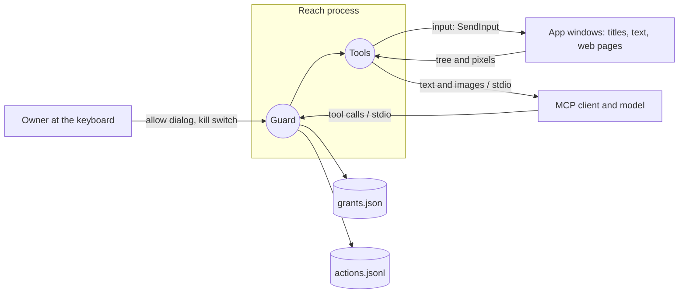

# Threat model: Reach (2026-11-17, Yasser with Claude)

## Diagram

Trust boundaries:

1. Model to Reach. The model is not trusted to choose its own reach. Every call crosses the guard.
2. Screen to model. Everything read from a window is data written by whoever controls that window's content.
3. Owner to Reach. Only physical input at the allow dialog and the kill switch carries authority.
4. Medium to high integrity. Elevated processes are out of bounds.

## Assets and assumptions

Assets: the owner's signed-in sessions in every open app, files reachable through any granted app, passwords typed on this machine.

Assumptions:

- The MCP client that starts Reach is one the owner chose. Anything able to edit that client's config already runs as the owner.
- `~/.reach` is writable only by the owner's account.
- The model may be steered by hostile screen content at any time.

## Threats

Owner of every row: Yasser. Each mitigation names the test that holds it.

| Id | Element | STRIDE | Description | Disposition |
|----|---------|--------|-------------|-------------|
| T1 | Screen to model | S | A page or document shows text posing as an instruction; the model acts on it | Mitigate: grants bound what can be reached; snapshot output is prefixed as screen data; kill switch; log. Residual risk accepted, A1 |
| T2 | Allow dialog | E | The model clicks Yes on its own allow dialog | Mitigate: guard refuses Reach's own process (`test_own_process_refused`); every call is refused while a dialog is open (`test_pending_dialog_blocks_input`) |
| T3 | Allow dialog | S | A window titles itself "Notepad" to borrow trust | Mitigate: the dialog and the grant use the executable path, never the title (`test_grant_keyed_by_path`) |
| T4 | Allow dialog | D | The model asks for app after app until the owner clicks Yes from fatigue | Mitigate: one dialog per app per run, a no is cached (`test_denial_cached`) |
| T5 | grants.json | T | The model, through a granted editor or terminal, writes itself a grant | Accept, A2. A granted shell already has the account |
| T6 | Tools to screen | E | Input lands on an ungranted window that sits over or steals focus from the target | Mitigate: point and foreground checks before each input (`test_tool_click_checks_app_under_point`, `test_tool_keys_check_foreground`). Race accepted, A3 |
| T7 | Tools to screen | E | Input to an elevated window or UAC prompt | Eliminate: a process whose token cannot be opened is refused (`test_uninspectable_refused`); Windows also blocks it |
| T8 | Screen to model | I | Snapshot or screenshot of an ungranted window leaks its content to the model | Mitigate: reads pass the same guard as writes (`test_tool_read_needs_grant`); screenshots capture one window, never the screen |
| T9 | Screen to model | I | A password value appears in a snapshot | Mitigate: password elements are redacted (`test_password_value_redacted`) |
| T10 | Tools to screen | I, E | The model types a password, or retypes one it was shown | Mitigate: typing refused when focus is a password element (`test_tool_password_focus_refuses_keys_and_keeps_text_out_of_log`) |
| T11 | Whole | R | The owner cannot tell afterwards what was done | Mitigate: every call logged with time, tool, app and outcome (`test_tool_every_call_logged`) |
| T12 | actions.jsonl | I | Typed text sits in the log in clear | Accept, A4 |
| T13 | Tools | D | A runaway model keeps clicking | Mitigate: kill switch is terminal for the run (`test_tool_refused_after_kill`) and is checked again at the last step before input, so it stops a call already typing (`test_kill_stops_input_already_in_flight`); server refuses to start without it |
| T14 | Dependencies | T | `mcp` or `comtypes` is compromised and runs as the owner | Accept, A5. Two direct dependencies, versions pinned by lower bound only |

| T15 | Tools to screen | E | A key combination the shell handles (Windows key, Alt+Tab, Ctrl+Esc, Ctrl+Shift+Esc) launches or switches to an app with no grant | Eliminate: the Windows key does not exist in the key table and the rest are refused (`test_tool_shell_and_paste_combos_refused`) |
| T16 | Clipboard | I | The model pastes what another app copied, a password included, into a granted plain field and reads it back | Mitigate: Ctrl+V and Shift+Insert are refused (`test_tool_shell_and_paste_combos_refused`). A paste through the app's own menu remains, A6 |
| T17 | Allow dialog | S | The dialog takes focus while the owner is typing elsewhere and a stray Y grants the app | Mitigate: No is the default button, and a yes inside the first second is discarded and asked again (`test_a_yes_inside_the_first_second_is_not_believed`) |
| T18 | Refs | T | A ref remembered from an older snapshot names a different element in the new one | Mitigate: refs carry the snapshot generation (`test_tool_old_ref_is_refused`) |

## Accepted risks

- A1. Injection through screen content cannot be detected by this layer. Review 2027-02-01.
- A2. A grant on a shell, editor or file manager lets the model change Reach's own files. The dialog warns for known shells (`test_allow_dialog_names_the_path_and_warns_for_shells`). Review 2027-02-01.
- A3. Check then act is two steps; a window appearing in the gap of a few milliseconds receives the input. Review 2027-02-01.
- A4. The log keeps typed text so the audit is useful. Password fields never reach it. Review 2027-02-01.
- A5. Dependencies are bounded to one major version (`comtypes>=1.4,<2`, `mcp>=2.3,<3`), with no lock file or hash pinning. Reviewed 2026-11-17 before going public; review again 2027-02-01.
- A6. A granted app's Edit menu or context menu can still paste. Blocking it would mean reading every menu. Review 2027-02-01.
